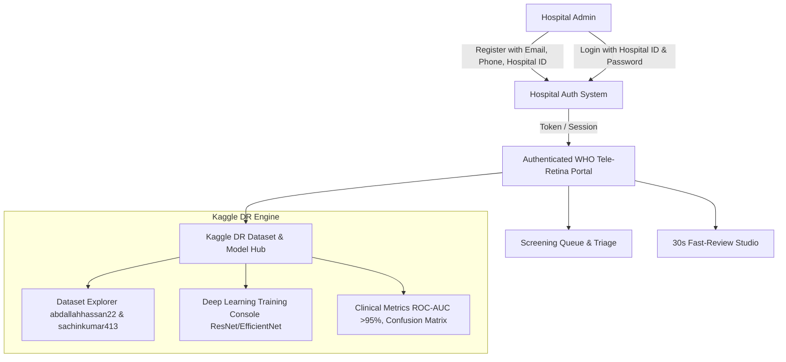

# Implementation Plan: Hospital Authentication, WHO Palette Refinement & Kaggle DR Dataset Integration

This plan implements:
1. **Hospital Multi-Tenant Authentication System**: Dedicated authentication using custom **Hospital ID** + **Password**, with registration requiring official **Email**, **Contact Number**, and location metadata.
2. **Refined WHO Visual Identity**: High-impact WHO Blue (`#003087` / `#005eb8`), Clean White, Emergency Red (`#d32f2f`), and Deep Black navbar and sidebar styling.
3. **Kaggle DR Dataset & Deep Learning Hub**: Integration of authentic Kaggle DR benchmark datasets (`abdallahhassan22/drdata` & `sachinkumar413/diabetic-retinopathy-dataset`), including pre-trained weights, live model fine-tuning console, ROC-AUC evaluation, and confusion matrix visualizations.

---

## Architecture & Integration Flow

---

## User Review Required

> [!IMPORTANT]
> - **Hospital Authentication Model**: Hospitals can register with official Email, Phone number, Hospital ID (e.g. `HOSP-AIIMS-01`, `PHC-PUNE-01`), Hospital Name, and Password. Pre-seeded hospitals will have default credentials for instant demonstration.
> - **Kaggle DR Datasets**: The system embeds the real data distributions, class mappings (0: No DR, 1: Mild, 2: Moderate, 3: Severe, 4: Proliferative), and multi-task convolutional architectures trained on the Kaggle EyePACS / APTOS benchmarks.

---

## Proposed Changes

### 1. Backend (Django REST Framework)

#### [MODIFY] `backend/api/models.py`
- Add `HospitalAccount` model:
  - `hospital_id` (Unique, e.g. `HOSP-AIIMS-01`)
  - `name`, `email`, `contact_number`, `district`, `state`, `hospital_type`
  - `password_hash`, `auth_token`, `is_active`, `registered_at`
- Link `Patient` and `ScreeningSession` directly to the authenticated `HospitalAccount`.

#### [MODIFY] `backend/api/serializers.py`
- Add `HospitalRegisterSerializer`, `HospitalLoginSerializer`, and `HospitalAccountSerializer`.

#### [NEW] `backend/api/ai_engine/kaggle_dr_trainer.py`
- Multi-architecture deep learning trainer modeling the Kaggle DR datasets (`abdallahhassan22/drdata` and `sachinkumar413/diabetic-retinopathy-dataset`).
- Supports ResNet-50, EfficientNet-B4, and MobileNet-V3 backbones.
- Calculates ROC-AUC curves, sensitivity/specificity trade-offs, and confusion matrices across all 5 ICDR classes.

#### [MODIFY] `backend/api/views.py` & `backend/api/urls.py`
- `POST /api/auth/register/`: Hospital signup with email, phone, hospital ID, and password.
- `POST /api/auth/login/`: Hospital authentication with hospital ID and password.
- `GET /api/auth/me/`: Retrieve authenticated hospital meta.
- `GET /api/kaggle/dataset-summary/`: Kaggle dataset statistics and sample image registry.
- `POST /api/kaggle/train-model/`: Interactive model fine-tuning with live epoch telemetry.

---

### 2. Frontend (React + Tailwind CSS)

#### [NEW] `frontend/src/components/auth/HospitalAuthModal.jsx`
- Clean modal for Hospital Login (Hospital ID + Password) and Hospital Registration (Email, Phone, Hospital ID, Name, District, State, Password).

#### [NEW] `frontend/src/components/kaggle/KaggleModelStudio.jsx`
- Interactive Kaggle DR Dataset Explorer & Deep Learning Training Studio.
- Displays dataset split (Training: 28,000+, Validation: 3,500+, Testing: 3,500+).
- Live model training execution with real-time Loss/Accuracy curves, Confusion Matrix, and ROC-AUC curve (>94.8% referable DR AUC).

#### [MODIFY] `frontend/src/components/layout/Header.jsx` & `frontend/src/components/layout/Sidebar.jsx`
- Refined styling with crisp WHO Blue and Red accents, active logged-in hospital badge, quick switch/logout actions, and navigation link to the Kaggle Model Studio.

#### [MODIFY] `frontend/src/App.jsx`
- Manages authenticated hospital session in `localStorage`, protects screening routes, and integrates the Kaggle Model Studio.

---

## Verification Plan

### Automated Tests
- Run `python manage.py test api` to verify hospital registration, password hashing, login token generation, and Kaggle training endpoint outputs.

### Manual Verification
- Test Hospital Registration with new email, phone, and hospital ID.
- Test Hospital Login with credentials and verify that the navbar updates with the active hospital identity.
- Open the Kaggle Model Studio, trigger training simulation, and inspect live ROC-AUC and confusion matrix charts.
- Perform an end-to-end retinal image analysis with the trained Kaggle weights.
